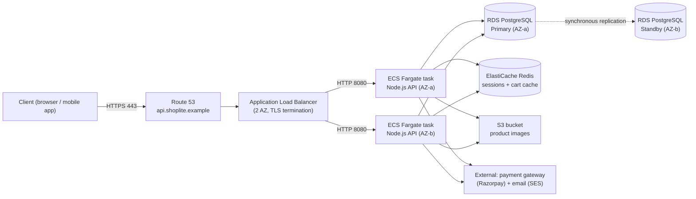
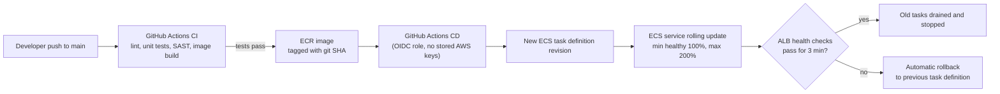
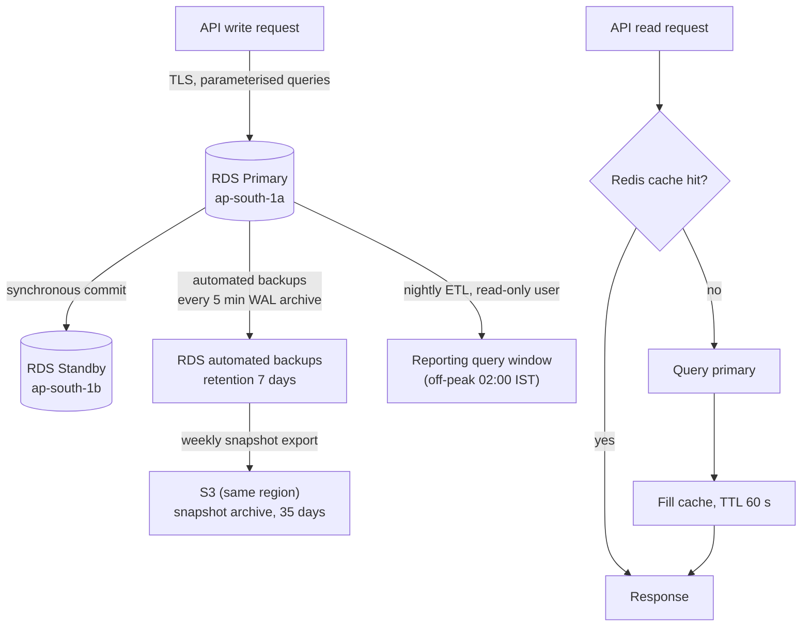

# Service Blueprint — ShopLite API (Two-Tier Web Service)

**Intern:** Suraj Dhakad · **Intern ID:** RAB-2026-7AFBF77314 · RabTech Academy, Task 02
**Stack:** ALB → ECS Fargate (Node.js API) → RDS PostgreSQL Multi-AZ + ElastiCache Redis
**Region:** ap-south-1 (Mumbai) · 2 Availability Zones (ap-south-1a, ap-south-1b)

## 1. System overview



Two-tier split: **Tier 1** is stateless (any task can serve any request; tasks
are disposable). **Tier 2** holds all durable state (PostgreSQL) and
semi-durable cache/session state (Redis). Nothing durable lives in Tier 1 —
this is what makes the deployment and failure paths below safe.

## 2. Request path (happy path, checkout as the worked example)

```mermaid
sequenceDiagram
    participant C as Client
    participant ALB as ALB
    participant API as Fargate API task
    participant R as Redis
    participant DB as RDS PostgreSQL
    participant PG as Payment gateway
    C->>ALB: POST /checkout (TLS, JWT in header)
    ALB->>API: forward to healthy task (health check /healthz)
    API->>API: validate JWT locally (JWKS cached 10 min)
    API->>R: GET cart:{userId} (5 ms budget)
    R-->>API: cart contents
    API->>DB: BEGIN; INSERT order; UPDATE stock (row lock)
    DB-->>API: commit OK (~20 ms)
    API->>PG: POST /payments (idempotency-key = orderId)
    PG-->>API: payment authorised
    API->>DB: UPDATE order SET status=PAID
    API->>R: DEL cart:{userId}
    API-->>C: 200 OK {orderId, status}
```

Path rules (apply to every request):

- **Timeouts:** client→ALB idle 60 s; API per-request deadline 10 s; DB query
  timeout 3 s (statement_timeout); Redis command timeout 200 ms; payment
  gateway timeout 5 s with the order left in `PAYMENT_PENDING` on timeout —
  never auto-charged twice (idempotency key).
- **Retries:** only idempotent GETs are retried by the client (max 2, jittered
  backoff). The API never retries writes; the payment call relies on the
  idempotency key for safe caller retry.
- **Latency budget:** p95 end-to-end target 300 ms (see SLO workbook):
  ALB 5 ms, API logic 100 ms, Redis 10 ms, DB 100 ms, serialisation/network
  85 ms headroom.

## 3. Dependency path

| Dependency | Type | Criticality | If it degrades | Mitigation in path |
|---|---|---|---|---|
| RDS PostgreSQL (primary) | Internal, hard | P0 — checkout/catalogue writes | Requests fail fast after 3 s query timeout | Multi-AZ synchronous standby, automatic failover (60–120 s); read endpoints can be served stale from Redis for catalogue GETs |
| ElastiCache Redis | Internal, soft | P1 — sessions, cart cache | Cache miss storm → DB load rises | Cache-aside with 60 s TTL on catalogue; cart falls back to DB table; circuit breaker stops Redis calls after 5 consecutive errors for 30 s |
| Payment gateway (Razorpay) | External, hard for checkout only | P0 for /checkout, irrelevant elsewhere | Checkout returns 202 with `PAYMENT_PENDING`; webhook reconciles final state | Idempotency keys, webhook + polling reconciliation job every 5 min |
| Amazon SES (email) | External, soft | P2 | Order emails delayed | Messages queued in SQS; worker retries with backoff for 24 h; order flow never blocks on email |
| S3 (product images) | Internal, soft | P2 | Images served from CloudFront cache | CloudFront in front of S3, 24 h TTL; API stores image URLs, never proxies bytes |
| Secrets Manager | Internal, control plane | P1 at boot only | Running tasks unaffected; new tasks can't start | Secrets cached by the task at boot; ECS task definition pins secret ARNs; rotation is non-disruptive (see ADR-003) |

Dependency principle: **exactly one hard dependency on the request path
(PostgreSQL)**. Everything else either fails open (Redis, SES, S3) or fails
into a queued/reconcilable state (payments).

## 4. Deployment path



Deployment contract:

- **Immutable artefacts:** one container image per git SHA; no in-place
  changes on running tasks.
- **Progressive rollout:** rolling update with `minimumHealthyPercent=100`,
  `maximumPercent=200`; new tasks must pass ALB health checks for 3 minutes
  before old tasks drain.
- **Database changes:** expand–migrate–contract. Migrations run as a
  one-off ECS task *before* the new app version starts, and must be
  backward-compatible with the previous app version so rollback never needs a
  down-migration.
- **Rollback:** automatic on failed health checks or on the
  `HighErrorRate` CloudWatch alarm during the deploy window; manual rollback
  is a single task-definition revision switch (< 2 min).
- **Environments:** dev → staging → prod, same image promoted unchanged;
  staging mirrors prod topology at minimum size (1 task, single-AZ RDS) to
  keep cost down.
- **No console changes:** all infrastructure is Terraform; manual console
  edits are treated as incidents (see ADR-004 for who may hold break-glass
  access).

## 5. Data path



Data rules:

- **Writes** go only to the primary; synchronous Multi-AZ replication means a
  committed write survives an AZ failure (RPO ≈ 0 for AZ loss; see ADR-002).
- **Reads:** cache-aside via Redis for catalogue/cart; everything else reads
  the primary (no read replica at this scale — revisit at Scenario 3, see
  cost model note).
- **Backups:** automated RDS backups with 5-minute transaction-log archiving
  (point-in-time recovery to any second in the last 7 days); weekly snapshot
  exported to S3 with a 35-day lifecycle. Restore is *tested* quarterly — an
  untested backup is not a backup.
- **Data classification:** PII (name, email, address, phone) lives only in
  PostgreSQL, encrypted at rest (KMS) and in transit (TLS 1.2+); payment card
  data never touches this service (gateway-hosted checkout).
- **Retention:** orders retained 7 years (accounting); application logs
  30 days hot; access logs 1 year in S3 (see cost model logging line).

## 6. Failure paths

| # | Failure | Detection | System behaviour | User impact | Recovery |
|---|---|---|---|---|---|
| F1 | One Fargate task crashes / OOM | ALB health check fails (3 × 10 s) | Task removed from rotation; ECS starts a replacement | None (other tasks serve) | Automatic, < 60 s |
| F2 | Whole AZ-a outage | ALB/ECS AZ health, RDS event | ALB routes to AZ-b tasks; RDS fails over to standby in AZ-b (DNS flip) | ~60–120 s of elevated errors during DB failover | Automatic; consumes error budget, pages on burn rate (see SLO workbook) |
| F3 | RDS primary failure (non-AZ) | RDS event + DB error alarm | Automatic Multi-AZ failover as F2 | As F2 | Automatic; post-incident check of replication lag |
| F4 | Redis unavailable | Cache error-rate alarm | Circuit breaker opens; reads fall through to DB; cart served from DB table | Higher latency (p95 may breach latency SLO), no failed checkouts | Automatic fallback; Redis failover to replica (~30 s) |
| F5 | Payment gateway down | 5xx/timeout rate from gateway | Checkout returns `PAYMENT_PENDING`; reconciliation via webhook/polling when gateway recovers | User told "payment is processing", never double-charged | Automatic reconciliation; support runbook if > 1 h |
| F6 | Bad deploy (error spike) | `HighErrorRate` alarm in deploy window | CD pipeline halts; automatic rollback to previous task definition | Brief error spike, minutes | Automatic rollback; deploy blocked until fix |
| F7 | Runaway DB load (cache stampede / bad query) | RDS CPU + active-session alarms | Statement timeout kills > 3 s queries; catalogue reads shift to Redis stale-serve mode | Stale catalogue data up to 5 min; checkout unaffected | Manual: kill query, fix index; feature-flag stale mode off |
| F8 | Region-wide AWS outage (ap-south-1) | AWS Health Dashboard | Service down — accepted risk at this scale (see ADR-001/002) | Full outage until region recovers or manual DR invoked | Manual DR: restore latest S3 snapshot into ap-south-2 (Hyderabad); RTO 4 h, RPO 24 h for this tier of disaster |

Failure-path principles: fail fast on the one hard dependency, fail open on
soft dependencies, never lose or duplicate money movement, and make every
automatic recovery cheaper than the error budget it consumes.

## 7. Traceability to the other artefacts

- Availability/latency targets used above are defined formally in
  `slo-workbook.csv`.
- F2/F3 failover and F8 DR objectives (RTO/RPO) are decided in
  `architecture-decisions.md` (ADR-002) and paid for in `cost-model.csv`
  (Multi-AZ RDS + backup lines).
